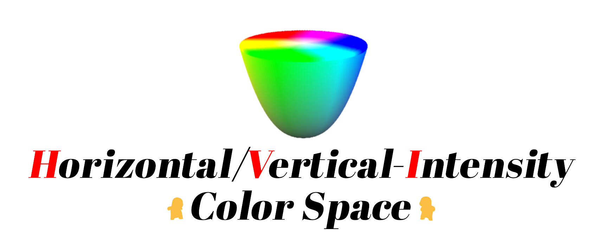
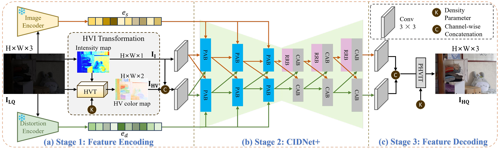
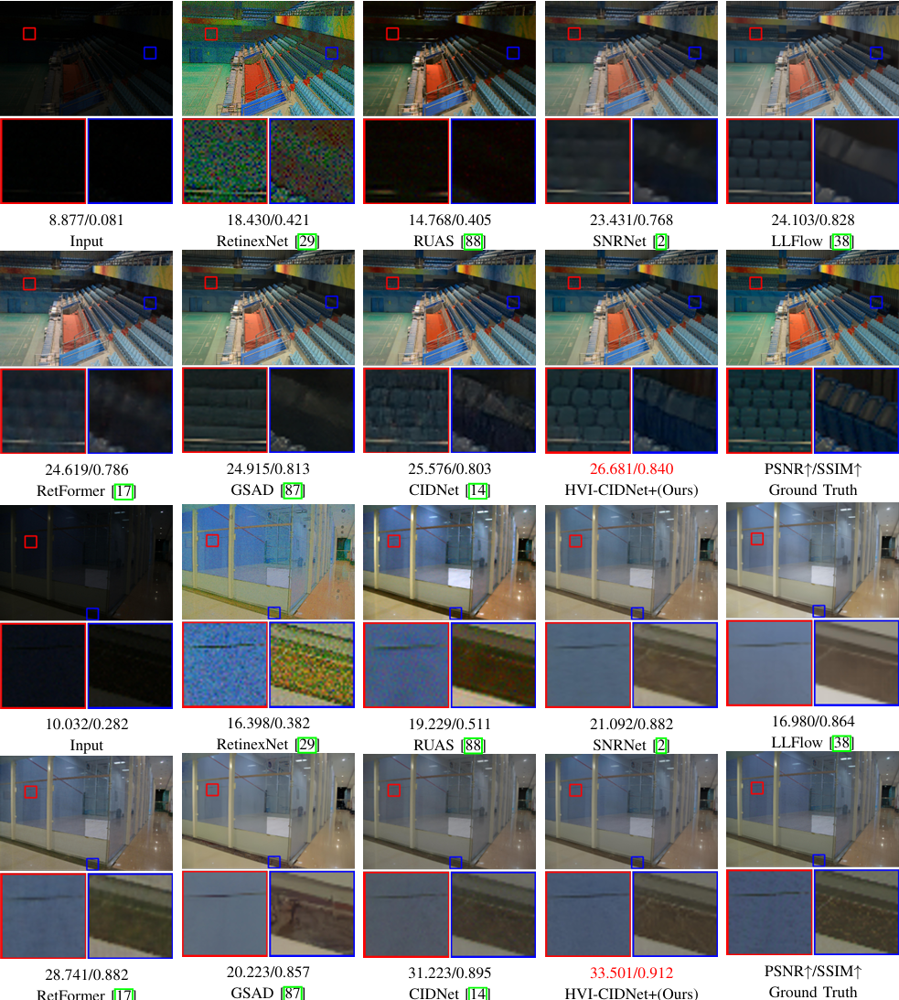
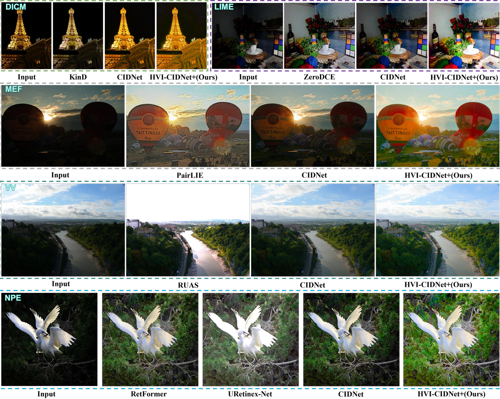

&nbsp;

<p align="center">  </p>

# HVI-CIDNet+: Beyond Extreme Darkness for Low-Light Image Enhancement

[Qingsen Yan](https://scholar.google.com/citations?user=BSGy3foAAAAJ), Kangbiao Shi, [Yixu Feng](https://scholar.google.com/citations?user=WljJ2HUAAAAJ), [Tao Hu](https://scholar.google.com/citations?user=BNkFUbsAAAAJ&hl=en&oi=sra), [Peng Wu](https://scholar.google.com/citations?user=QkNqUH4AAAAJ),  [Guansong Pang](https://scholar.google.com/citations?user=1ZO7pHkAAAAJ&hl=en)

</details>

## News 🆕
- **2025.07.11** Upgraded version paper as "HVI-CIDNet+: Beyond Extreme Darkness for Low-Light Image Enhancement" in [Arxiv](https://arxiv.org/abs/2507.06814). The new code, models and results will be uploaded soon. (code_link：[Github](https://github.com/shikangbiao/CIDNet_extension)) 🔥

## Proposed HVI-CIDNet+ ⚙ 

<details close>
<summary><b>HVI-CIDNet+ pipeline:</b></summary>



</details>

## Visual Comparison 🖼 
<details close>
<summary><b>LOL-v1, LOL-v2-real, and LOL-v2-synthetic:</b></summary>



</details>

<details close>
<summary><b>DICM, LIME, MEF, NPE, and VV:</b></summary>




</details>

## 1. Get Started 🌑

### Dependencies and Installation

(1) Clone Repo

```bash
git clone git@github.com:shikangbiao/CIDNet_extension.git
```

(2) Install Dependencies

```bash
conda env create -f HVI-CIDNet+.yaml
```


### Data Preparation

You can refer to the following links to download the datasets.

- [LOLv1](https://daooshee.github.io/BMVC2018website/)
- LOLv2: [Baidu Pan](https://pan.baidu.com/s/17KTa-6GUUW22Q49D5DhhWw?pwd=yixu) (code: `yixu`) and  [One Drive](https://1drv.ms/u/c/2985db836826d183/EYPRJmiD24UggCmCAQAAAAABEbg62rx0FG21FwLQq0jzLg?e=Im12UA) (code: `yixu`) 
- DICM,LIME,MEF,NPE,VV: [Baidu Pan](https://pan.baidu.com/s/1FZ5HWT30eghGuaAqqpJGaw?pwd=yixu)(code: `yixu`) and [One Drive](https://1drv.ms/f/s!AoPRJmiD24UphBNGBbsDmSwppNPf?e=2yGImv)(code: `yixu`)
- SICE: [Baidu Pan](https://pan.baidu.com/s/13ghnpTBfDli3mAzE3vnwHg?pwd=yixu)(code: `yixu`) and [One Drive](https://1drv.ms/u/s!AoPRJmiD24UphAlaTIekdMLwLZnA?e=WxrfOa)(code: `yixu`)
- Sony-Total-Dark(SID): [Baidu Pan](https://pan.baidu.com/s/1mpbwVscbAfQJtkrrzBzJng?pwd=yixu)(code: `yixu`) and [One Drive](https://1drv.ms/u/s!AoPRJmiD24UphAie9l0DuMN20PB7?e=Zc5DcA)(code: `yixu`)

Then, put them in the following folder:

<details close> <summary>datasets (click to expand)</summary>

```
├── datasets
	├── DICM
	├── LIME
	├── LOLdataset
		├── our485
			├──low
			├──high
		├── eval15
			├──low
			├──high
	├── LOLv2
		├── Real_captured
			├── Train
				├── Low
				├── Normal
			├── Test
				├── Low
				├── Normal
		├── Synthetic
			├── Train
				├── Low
				├── Normal
			├── Test
				├── Low
				├── Normal
	├── MEF
	├── NPE
	├── SICE
		├── Dataset
			├── eval
				├── target
				├── test
			├── label
			├── train
				├── 1
				├── 2
				...
		├── SICE_Grad
		├── SICE_Mix
		├── SICE_Reshape
	├── Sony_total_dark
		├── eval
			├── long
			├── short
		├── test
			├── long
				├── 10003
				├── 10006
				...
			├── short
				├── 10003
				├── 10006
				...
		├── train
			├── long
				├── 00001
				├── 00002
				...
			├── short
				├── 00001
				├── 00002
				...
	├── VV
```
</details>

## 2. Testing 🌒


Download our weights from [[Google Drive](https://drive.google.com/drive/folders/1bHNXq-3nSxh0QeyeG4dqcxtXw-Y-JbUY?usp=drive_link)]

- **You can test our HVI-CIDNet+ as followed, all the results will saved in `./output` folder:**

<details close> <summary>(click to expand)</summary>

```bash
# LOLv1
python eval.py --lol

# LOLv2-real
python eval.py --lol_v2_real

# LOLv2-syn
python eval.py --lol_v2_syn

# SICE
python eval.py --SICE_grad # output SICE_grad
python eval.py --SICE_mix # output SICE_mix

# Sony-Total-Dark
python eval_SID.py --SID

# five unpaired datasets DICM, LIME, MEF, NPE, VV. 
# You can change "--DICM" to the other unpaired datasets "LIME, MEF, NPE, VV".
python eval.py --unpaired --DICM
```

</details>

- **Also, you can test all the metrics mentioned in our paper as follows:**
  
  
<details close> <summary>(click to expand)</summary>

```bash
# LOLv1
python measure.py --lol

# LOLv2-real
python measure.py --lol_v2_real

# LOLv2-syn
python measure.py --lol_v2_syn

# Sony-Total-Dark
python measure_SID.py --SID

# SICE-Grad
python measure.py --SICE_grad

# SICE-Mix
python measure.py --SICE_mix

# five unpaired datasets DICM, LIME, MEF, NPE, VV. 
# You can change "--DICM" to the other unpaired datasets "LIME, MEF, NPE, VV".
python measure_niqe_bris.py --DICM

# Note: Following LLFlow, KinD, and Retinxformer, we have also adjusted the brightness of the output image produced by the network, based on the average value of GroundTruth (GT). This only works in paired datasets. If you want to measure it, please add "--use_GT_mean".
# 
# e.g.
python measure.py --lol --use_GT_mean
  
```

</details>

- **Evaluating the Parameters, FLOPs, and running time of HVI-CIDNet+:**

```bash
python net_test.py
```


## 3. Training 🌓

The training code will be uploaded soon.

## 4. Contacts 🌔

If you have any questions, please contact us or submit an issue to the repository!

Kangbiao Shi (18334840904@163.com)

## 5. Citation 🌕

If you find our work useful for your research, please cite our paper

```
@article{yan2025hvi,
  title={HVI-CIDNet+: Beyond Extreme Darkness for Low-Light Image Enhancement},
  author={Yan, Qingsen and Shi, Kangbiao and Feng, Yixu and Hu, Tao and Wu, Peng and Pang, Guansong and Zhang, Yanning},
  journal={arXiv preprint arXiv:2507.06814},
  year={2025}
}

@inproceedings{yan2025hvi,
  title={Hvi: A new color space for low-light image enhancement},
  author={Yan, Qingsen and Feng, Yixu and Zhang, Cheng and Pang, Guansong and Shi, Kangbiao and Wu, Peng and Dong, Wei and Sun, Jinqiu and Zhang, Yanning},
  booktitle={Proceedings of the Computer Vision and Pattern Recognition Conference},
  pages={5678--5687},
  year={2025}
}
```
